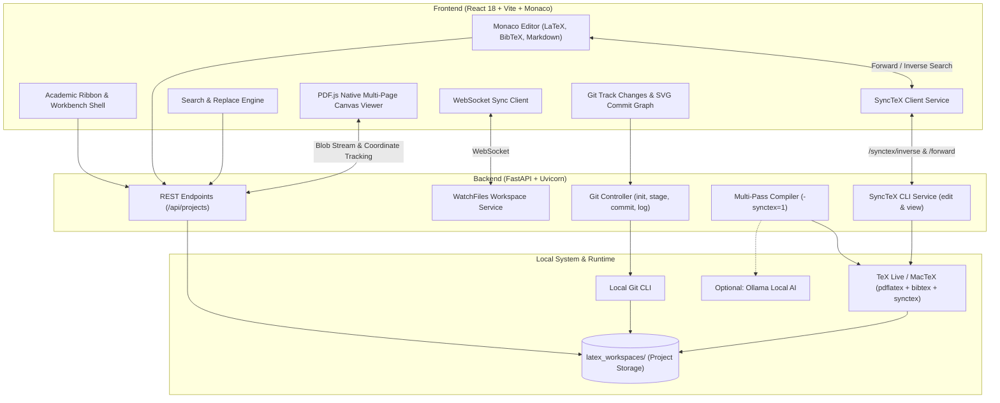

# Aegis Research — Scholarly LaTeX IDE & Research Workbench

<p align="center">
  <strong>A local-first, privacy-focused scholarly LaTeX IDE and academic research workbench.</strong><br>
  Combining Word-style academic Ribbon accessibility with VS Code-grade editing, multi-pass LaTeX compilation, real-time Git tracking, and live PDF rendering.
</p>

<p align="center">
  
  
  
  
  
</p>

---

## 📖 Overview

Writing academic papers, theses, and technical publications in LaTeX often forces researchers to choose between heavy desktop IDEs, slow cloud editors, or disconnected terminal workflows.

**Aegis Research** bridges this gap:
- **100% Local & Private**: All documents and assets stay on your machine. Zero cloud lock-in.
- **Academic Ribbon Interface**: Familiar, organized layout (`Home`, `Insert`, `Review`) for rapid formatting and manuscript navigation.
- **Native LaTeX & SyncTeX Engine**: Directly interfaces with your local TeX distribution (`pdflatex` + `bibtex` + `synctex`) with automatic multi-pass compilation and bidirectional navigation.
- **Bidirectional SyncTeX Navigation**: Double-click PDF text to jump to the exact LaTeX source line (Inverse Search), or press `Cmd/Ctrl + Alt + J` / click "Sync to PDF" to locate source lines in the preview (Forward Search).
- **Embedded Git Studio**: Built-in visual commit and branch graph, staging, diff inspection, and branch switching tailored for scientific writing.
- **Native PDF.js Multi-Page Viewer**: High-performance continuous scroll canvas viewer supporting zoom, Fit Width, Fit Page, High-DPI/Retina displays, and 100% aspect ratio preservation.
- **Local AI-Ready**: Optional offline assistance powered by [Ollama](https://ollama.com) for syntax diagnostic and automated error recovery.

---

## 🏛️ Architecture



---

## ⚡ Quickstart

### 1. Clone the Repository
```bash
git clone https://github.com/aditlab-code/AegisResearch.git
cd AegisResearch
```

### 2. Run Automated Setup
```bash
chmod +x setup.sh run.sh
./setup.sh
```
*`setup.sh` detects your operating system (macOS, Ubuntu/Debian, Fedora, or WSL), validates compilers, sets up Python virtual environments, creates sample workspace projects, and installs npm packages.*

### 3. Start Fullstack Services
```bash
./run.sh
```

- **IDE Web Interface**: [http://localhost:5173](http://localhost:5173)
- **Backend API Docs**: [http://localhost:8000/docs](http://localhost:8000/docs)
- **To Stop**: Press `Ctrl + C` (gracefully stops both backend and frontend).

---

## ✨ Features at a Glance

### 1. Two-Tier Academic Ribbon Toolbar
- **Home Tab**: Clipboard, typography formatting, equation insertions, compiler controls, and status counters.
- **Insert Tab**: Quick insertion of mathematical equations, figures, tables, bibliography blocks, and footnotes.
- **Review Tab**: Annotation manager scanning `TODO`, `FIXME`, and comments with instant jump-to-line navigation.

### 2. Multi-Pass Local Compiler
- Executes local `pdflatex` and `bibtex` in asynchronous subprocesses.
- Automatically detects `\citation` and `\bibdata` to execute multi-pass compiles (`pdflatex` &rarr; `bibtex` &rarr; `pdflatex`).
- Intelligent log parser surfaces clear, actionable LaTeX errors without requiring you to dig through 1,000-line `.log` files.

### 3. Git Track Changes & Interactive SVG Commit Graph
- Real-time detection of unstaged, staged, and untracked files.
- Visual commit and branch graph rendering commit dots, parent paths, branch badges, authors, and timestamps.
- One-click file staging, un-staging, discarding, and commit creation.

### 4. Global Search & Replace
- Fast project-wide search with Case Sensitivity, Whole Word, and Regex support.
- Single match hover replacement or global "Replace All" across all project files.

### 5. Seamless Theming
- Switch between crisp Light Mode and distraction-free Dark Mode with state persisted across sessions.

### 6. Bidirectional SyncTeX Navigation
- **Inverse Search (PDF &rarr; Source)**: Double-click anywhere on the rendered PDF preview to jump directly to the corresponding LaTeX line in Monaco Editor. The IDE scrolls smoothly, sets focus, pulses the active line for 1.5 seconds, and automatically switches tabs if the text is in an included subfile.
- **Forward Search (Source &rarr; PDF)**: Press `Cmd/Ctrl + Alt + J` or click the "Sync to PDF" ribbon button from any line in your `.tex` document to jump straight to the exact page and display a pulsing highlight box over the corresponding text block in the PDF preview.

### 7. Native PDF.js Multi-Page Viewer
- Pure `pdfjs-dist` continuous multi-page canvas rendering guaranteeing 100% paper aspect-ratio accuracy (A4, Letter, Beamer slides) with zero CSS distortion.
- High-DPI/Retina display scaling with explicit canvas transformation matrices, rendering razor-sharp text on high-density screens without clipping.
- Responsive toolbar controls for Zoom (25%–300%), Fit Width, and Fit Page with instant recalculation on pane resizing.

---

## 📁 Repository Structure

```
AegisResearch/
├── setup.sh                  # Automated multi-platform dependency bootstrapper
├── run.sh                    # Concurrent fullstack runner with clean trap handler
├── README.md                 # Primary documentation
├── package.json              # Frontend package configuration & npm scripts
├── vite.config.ts            # Vite configuration & proxy definitions
├── docs/
│   ├── HOW_TO_INSTALL.md     # Comprehensive cross-platform installation guide
│   ├── RELEASE_NOTES.md      # Official v0.1.0 release notes
│   ├── roadmap.md            # Project development roadmap
│   └── spec-synctex-bidirectional.md # SyncTeX bidirectional specification
├── backend/
│   ├── main.py               # FastAPI application & REST/WebSocket routes
│   ├── config.py             # Server host, port, CORS, and workspace path config
│   ├── requirements.txt      # Python dependencies
│   ├── services/
│   │   ├── compiler.py       # LaTeX multi-pass subprocess compiler (-synctex=1)
│   │   ├── synctex.py        # SyncTeX forward/inverse CLI coordinator
│   │   └── git_service.py    # Git operations & revision history manager
│   ├── test_compiler.py      # Multi-pass LaTeX compilation tests
│   ├── test_synctex.py       # SyncTeX CLI parser & coordinate tests
│   └── latex_workspaces/     # Local workspace storage for user LaTeX projects
└── src/
    ├── components/
    │   ├── editor/           # Monaco CodeEditor with pulse line highlight
    │   ├── header/           # TitleBar & RibbonBar toolbar ("Sync to PDF" action)
    │   ├── sidebar/          # FileTree, GitTrackPanel, SearchPanel, ReviewNotes
    │   └── preview/          # PDFViewer native canvas & PreviewPanel/Toolbar
    ├── services/             # Frontend API clients (projects, search, git, synctex)
    ├── hooks/                # Custom hooks (shortcuts, git, compile, file tree)
    └── types/                # TypeScript interface definitions
```

---

## ⚙️ Configuration & Environment Variables

The backend can be configured via environment variables or a `.env` file located in `backend/.env`:

| Variable | Default | Description |
|---|---|---|
| `HOST` | `0.0.0.0` | Backend bind host address |
| `PORT` | `8000` | Backend port |
| `WORKSPACE_DIR` | `backend/latex_workspaces` | Directory where user LaTeX projects are stored |
| `CORS_ORIGINS` | `http://localhost:5173,http://localhost:3000` | Comma-separated allowed frontend origins |

---

## 📚 Documentation
- [How to Install (macOS, Linux, WSL)](docs/HOW_TO_INSTALL.md)
- [Release Notes v0.1.0](docs/RELEASE_NOTES.md)
- [Project Roadmap](docs/roadmap.md)
- [SyncTeX Bidirectional Spec](docs/spec-synctex-bidirectional.md)

---

## 🧪 Development & Quality Gates

Run the verification suite locally:

```bash
# Verify shell runner syntax
bash -n setup.sh && bash -n run.sh

# Type-check and build frontend
rtk npm run build

# Run backend unit & integration test suite (35+ tests)
rtk backend/.venv/bin/pytest backend/test_*.py
```

---

## 📄 License & Attribution

Distributed under the MIT License. Developed with care for the academic and scientific open-source community by [aditlab-code](https://github.com/aditlab-code).
