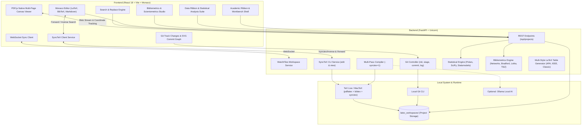

# Aegis Research — Scholarly LaTeX IDE & Research Workbench

<p align="center">
  <strong>A local-first, privacy-focused scholarly LaTeX IDE and academic research workbench.</strong><br>
  Combining ergonomic academic Ribbon accessibility with VS Code-grade editing, multi-pass LaTeX compilation, real-time Git tracking, and live PDF rendering.
</p>

<p align="center">
  
  
  
  
  
</p>

---

## 📖 Overview

Writing academic papers, theses, and technical publications in LaTeX often forces researchers to choose between heavy desktop IDEs, slow cloud editors, or disconnected terminal workflows.

**Aegis Research** bridges this gap:
- **100% Local & Private**: All documents and assets stay on your machine. Zero cloud lock-in.
- **Academic Ribbon Interface**: Familiar, organized layout (`Home`, `Insert`, `Review`) for rapid formatting and manuscript navigation.
- **Native LaTeX & SyncTeX Engine**: Directly interfaces with your local TeX distribution (`pdflatex` + `bibtex` + `synctex`) with automatic multi-pass compilation and bidirectional navigation.
- **Bidirectional SyncTeX Navigation**: Double-click PDF text to jump to the exact LaTeX source line (Inverse Search), or press `Cmd/Ctrl + Alt + J` / click "Sync to PDF" to locate source lines in the preview (Forward Search).
- **Embedded Git Studio**: Built-in visual commit and branch graph, staging, diff inspection, and branch switching tailored for scientific writing.
- **Statistical Research Workbench & Data Ribbon**: Integrated quantitative analysis and scientific data workbench. Inspect datasets, run parametric & non-parametric tests, follow methodological guardrails, and generate publication-ready LaTeX tables (APA, IEEE, Classic) in one click.
- **Bibliometrics & Scientometrics Studio**: Integrated scientific literature analysis workbench. Parse BibTeX corpora, analyze keyword co-occurrence & co-authorship networks, generate Callon 2x2 thematic strategic maps, track longitudinal thematic evolution across time slices via Sankey diagrams, validate Bradford and Lotka scientific laws, clean SLR stopwords, and export publication-ready LaTeX TikZ figures directly into your manuscript.
- **Native PDF.js Multi-Page Viewer**: High-performance continuous scroll canvas viewer supporting zoom, Fit Width, Fit Page, High-DPI/Retina displays, and 100% aspect ratio preservation.
- **Local AI-Ready**: Optional offline assistance powered by [Ollama](https://ollama.com) for syntax diagnostic and automated error recovery.

---

## 🏛️ Architecture



---

## ⚡ Quickstart

### 1. Clone the Repository
```bash
git clone https://github.com/aditlab-code/AegisResearch.git
cd AegisResearch
```

### 2. Run Automated Setup
```bash
chmod +x setup.sh run.sh
./setup.sh
```
*`setup.sh` detects your operating system (macOS, Ubuntu/Debian, Fedora, or WSL), validates compilers, sets up Python virtual environments, creates sample workspace projects, and installs npm packages.*

### 3. Start Fullstack Services
```bash
./run.sh
```

- **IDE Web Interface**: [http://localhost:5173](http://localhost:5173)
- **Backend API Docs**: [http://localhost:8000/docs](http://localhost:8000/docs)
- **To Stop**: Press `Ctrl + C` (gracefully stops both backend and frontend).

---

## ✨ Features at a Glance

### 1. Two-Tier Academic Ribbon Toolbar
- **Home Tab**: Clipboard, typography formatting, equation insertions, compiler controls, and status counters.
- **Insert Tab**: Quick insertion of mathematical equations, figures, tables, bibliography blocks, and footnotes.
- **Review Tab**: Annotation manager scanning `TODO`, `FIXME`, and comments with instant jump-to-line navigation.

### 2. Multi-Pass Local Compiler
- Executes local `pdflatex` and `bibtex` in asynchronous subprocesses.
- Automatically detects `\citation` and `\bibdata` to execute multi-pass compiles (`pdflatex` &rarr; `bibtex` &rarr; `pdflatex`).
- Intelligent log parser surfaces clear, actionable LaTeX errors without requiring you to dig through 1,000-line `.log` files.

### 3. Git Track Changes & Interactive SVG Commit Graph
- Real-time detection of unstaged, staged, and untracked files.
- Visual commit and branch graph rendering commit dots, parent paths, branch badges, authors, and timestamps.
- One-click file staging, un-staging, discarding, and commit creation.

### 4. Global Search & Replace
- Fast project-wide search with Case Sensitivity, Whole Word, and Regex support.
- Single match hover replacement or global "Replace All" across all project files.

### 5. Seamless Theming
- Switch between crisp Light Mode and distraction-free Dark Mode with state persisted across sessions.

### 6. Bidirectional SyncTeX Navigation
- **Inverse Search (PDF &rarr; Source)**: Double-click anywhere on the rendered PDF preview to jump directly to the corresponding LaTeX line in Monaco Editor. The IDE scrolls smoothly, sets focus, pulses the active line for 1.5 seconds, and automatically switches tabs if the text is in an included subfile.
- **Forward Search (Source &rarr; PDF)**: Press `Cmd/Ctrl + Alt + J` or click the "Sync to PDF" ribbon button from any line in your `.tex` document to jump straight to the exact page and display a pulsing highlight box over the corresponding text block in the PDF preview.

### 7. Native PDF.js Multi-Page Viewer
- Pure `pdfjs-dist` continuous multi-page canvas rendering guaranteeing 100% paper aspect-ratio accuracy (A4, Letter, Beamer slides) with zero CSS distortion.
- High-DPI/Retina display scaling with explicit canvas transformation matrices, rendering razor-sharp text on high-density screens without clipping.
- Responsive toolbar controls for Zoom (25%–300%), Fit Width, and Fit Page with instant recalculation on pane resizing.

### 8. Statistical Research Workbench & Data Ribbon
- **Dedicated Data Ribbon**: Ergonomic action cards organized into Data Management, Assumption Tests, Parametric, Non-Parametric, Multivariate, and Output Actions.
- **Measurement Scale Guardrails**: Automatic validation based on Stevens' 4 measurement scales (Nominal, Ordinal, Interval, Ratio) ensuring researchers never execute incompatible hypothesis tests.
- **Interactive Statistical Method Advisor**: Modal guide illustrating the standard 4-step quantitative empirical research workflow (Instrument Reliability &rarr; Normality &rarr; Homoscedasticity &rarr; Hypothesis Testing).
- **Comprehensive Statistical Test Suite**:
  - *Prerequisite & Assumption Tests*: Shapiro-Wilk, Kolmogorov-Smirnov, Levene's Test, Cronbach's Alpha instrument reliability.
  - *Parametric Tests*: One-Sample t-Test, Independent Samples t-Test (Student & Welch's correction), Paired t-Test, One-Way ANOVA (Tukey HSD post-hoc), Two-Way Factorial ANOVA, Bivariate Pearson Correlation, Multiple Linear Regression (VIF collinearity), MANOVA (Wilks' Lambda), and PCA.
  - *Non-Parametric Tests*: Mann-Whitney U, Wilcoxon Signed-Rank, Kruskal-Wallis H, Spearman Rank Correlation, and Chi-Square Test of Independence.
- **Dynamic Multi-Style LaTeX Table Generator**: Generates publication-ready LaTeX tables across APA (`booktabs`), IEEE, and Classic LaTeX styles, rendered inside a dedicated full centered modal dialog with instant copy-to-clipboard and insert-to-editor triggers.

### 9. Bibliometrics & Scientometrics Studio
- **Ergonomic 3-Column Studio Layout**: Navigation & Corpus Statistics (left), Interactive Visual Viewport (center), and Context-Aware Configuration & Inspection Panel (right).
- **Co-Occurrence & Collaboration Networks**: Keyword co-occurrence and co-authorship networks with normalization (Jaccard, Cosine, Association Strength), collision avoidance physics, and custom node styling.
- **Thematic Map (Callon's Strategic Diagram)**: 2x2 quadrant visualization mapping research themes across Centrality (relevance degree) and Density (development degree) into Motor Themes, Highly Developed/Niche Themes, Emerging/Declining Themes, and Basic/Transversal Themes.
- **Longitudinal Thematic Evolution**: Interactive Sankey flow diagram tracking thematic shifts across customizable time periods (2, 3, or 4 time slices) via thematic Inclusion Index.
- **Scientometric Laws of Distribution**:
  - *Bradford's Law of Scattering*: Partitioning journal sources into 3 core concentric zones with continuous rank visualization.
  - *Lotka's Law of Author Productivity*: Frequency-degree author power-law analysis with automated Kolmogorov-Smirnov (K-S) goodness-of-fit validation and critical value computation.
- **SLR Stopword Management**: Dedicated Systematic Literature Review (SLR) stopword filtering with 1-click exclusion of top corpus keywords.
- **Native LaTeX TikZ Vector Export**: One-click generation of compile-ready PGFPlots/TikZ figures for direct inclusion into LaTeX publications without loss of vector fidelity.

---

## 📁 Repository Structure

```
AegisResearch/
├── setup.sh                  # Automated multi-platform dependency bootstrapper
├── run.sh                    # Concurrent fullstack runner with clean trap handler
├── README.md                 # Primary documentation
├── package.json              # Frontend package configuration & npm scripts
├── vite.config.ts            # Vite configuration & proxy definitions
├── docs/
│   ├── HOW_TO_INSTALL.md     # Comprehensive cross-platform installation guide
│   └── RELEASE_NOTES.md      # Official release notes
├── backend/
│   ├── main.py               # FastAPI application & REST/WebSocket routes
│   ├── config.py             # Server host, port, CORS, and workspace path config
│   ├── requirements.txt      # Python dependencies
│   ├── services/
│   │   ├── compiler.py       # LaTeX multi-pass subprocess compiler (-synctex=1)
│   │   ├── synctex.py        # SyncTeX forward/inverse CLI coordinator
│   │   ├── git_service.py    # Git operations & revision history manager
│   │   ├── stats.py          # Descriptive, reliability & assumption statistics
│   │   ├── stats_parametric.py # Parametric hypothesis tests & regressions
│   │   ├── stats_nonparametric.py # Non-parametric rank & association tests
│   │   ├── latex_table_gen.py # Dynamic APA/IEEE/Classic LaTeX table generator
│   │   └── bibliometrics.py  # Scientometrics, networks, Bradford, Lotka & TikZ
│   ├── test_compiler.py      # Multi-pass LaTeX compilation tests
│   ├── test_synctex.py       # SyncTeX CLI parser & coordinate tests
│   ├── test_stats.py         # Statistical calculation unit tests
│   ├── test_stats_api.py     # Statistics API integration tests
│   ├── test_bibliometrics.py # Bibliometric engine unit tests
│   ├── test_bibliometrics_api.py # Bibliometric API integration tests
│   └── latex_workspaces/     # Local workspace storage for user LaTeX projects
└── src/
    ├── components/
    │   ├── editor/           # Monaco CodeEditor with pulse line highlight
    │   ├── header/           # TitleBar & RibbonBar toolbar ("Sync to PDF", Data Ribbon)
    │   ├── sidebar/          # FileTree, GitTrackPanel, SearchPanel, ReviewNotes
    │   ├── preview/          # PDFViewer native canvas & PreviewPanel/Toolbar
    │   ├── stats/            # Statistical AnalysisDialog, ResultsViewer, MethodAdvisor
    │   └── bibliometrics/    # Bibliometrics Studio (layout, panels, views, hooks)
    ├── services/             # Frontend API clients (projects, search, git, synctex, stats)
    ├── hooks/                # Custom hooks (shortcuts, git, compile, file tree)
    └── types/                # TypeScript interface definitions (stats, documents)
```

---

## ⚙️ Configuration & Environment Variables

The backend can be configured via environment variables or a `.env` file located in `backend/.env`:

| Variable | Default | Description |
|---|---|---|
| `HOST` | `0.0.0.0` | Backend bind host address |
| `PORT` | `8000` | Backend port |
| `WORKSPACE_DIR` | `backend/latex_workspaces` | Directory where user LaTeX projects are stored |
| `CORS_ORIGINS` | `http://localhost:5173,http://localhost:3000` | Comma-separated allowed frontend origins |

---

## 📚 Documentation
- [How to Install (macOS, Linux, WSL)](docs/HOW_TO_INSTALL.md)
- [Release Notes](docs/RELEASE_NOTES.md)
- [Project Roadmap](docs/internal/roadmap.md)
- [System Architecture](docs/internal/architecture.md)

---

## 🧪 Development & Quality Gates

Run the verification suite locally:

```bash
# Verify shell runner syntax
bash -n setup.sh && bash -n run.sh

# Type-check and build frontend
rtk npm run build

# Check frontend code formatting
rtk npm run format:check

# Run backend unit & integration test suite (85 tests)
rtk backend/.venv/bin/pytest backend/

# Check backend Python code formatting
rtk backend/.venv/bin/ruff format --check backend/
```

---

## 📄 License & Attribution

Distributed under the MIT License. Developed with care for the academic and scientific open-source community by [aditlab-code](https://github.com/aditlab-code).
