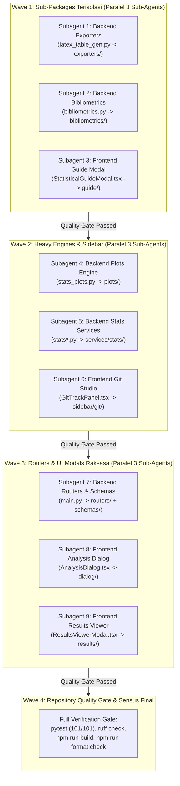

# Slicing and Maintainable Code Architecture

> **Objective**: 
> 1. Merefactor seluruh file dengan ukuran 1.000++ baris ke dalam sub-packages/sub-komponen modular agar mudah di-maintain dan siap untuk modul SEM-PLS.
> 2. Zero-Regression & Secure Refactor: Menjaga integritas 101+ unit tests backend dan build TypeScript frontend tetap 100% lulus di setiap iterasi.

---

## 1. Sensus File Raksasa Codebase (Aktual)

Berdasarkan audit baris riil repositori Aegis Research:

| Peringkat | Lokasi File | Ukuran Riil | Domain | Keterangan & Target Pemecahan |
| :---: | :--- | :---: | :---: | :--- |
| 1 | `backend/main.py` | **3.255 baris** | Backend Core | Monolitik Pydantic schemas, REST endpoints, & WebSocket. Dipecah ke `backend/schemas/` dan `backend/routers/`. Target: ~80 baris. |
| 2 | `src/components/stats/ResultsViewerModal.tsx` | **3.076 baris** | Frontend Stats | Render puluhan hasil uji statistik & plot trigger. Dipecah ke `src/components/stats/results/`. Target shell: ~180 baris. |
| 3 | `src/components/stats/AnalysisDialog.tsx` | **2.458 baris** | Frontend Stats | 14+ formulir konfigurasi uji statistik menumpuk. Dipecah ke `src/components/stats/dialog/` dengan `testRegistry.ts`. Target shell: ~150 baris. |
| 4 | `backend/services/stats_plots.py` | **1.375 baris** | Backend Plots | Generator Matplotlib headless (QQ plot, ROC, interaction, dsb.). Dipecah ke `backend/services/plots/`. |
| 5 | `src/components/stats/StatisticalGuideModal.tsx` | **1.205 baris** | Frontend Stats | Modal panduan statistik statis (Wizard, Matrix, Workflow). Dipecah ke `src/components/stats/guide/`. |
| 6 | `src/components/sidebar/GitTrackPanel.tsx` | **1.096 baris** | Frontend Git | Staging files, commit, branch, dan visualisasi commit graph DAG. Dipecah ke `src/components/sidebar/git/`. |
| 7 | `backend/services/latex_table_gen.py` | **986 baris** | Backend Exporters | Generator tabel LaTeX (APA, IEEE, Classic). Dipecah ke `backend/services/exporters/`. |
| 8 | `backend/services/stats_parametric.py` | **909 baris** | Backend Stats | Uji T-Test, ANOVA 1-Way & 2-Way, ANCOVA, korelasi Pearson. Dipecah ke `backend/services/stats/`. |
| 9 | `backend/services/bibliometrics.py` | **850 baris** | Backend Biblio | Mesin korpus BibTeX, jaringan co-occurrence, peta Callon, dan hukum sains. Dipecah ke `backend/services/bibliometrics/`. |
| 10 | `src/types/stats.ts` | **733 baris** | Frontend Types | Definisi type & interface request/response data statistik. |

---

## 2. Aturan Eksekusi Orkestrator (Guardrails)

Setiap tahapan pemecahan file wajib mematuhi ketentuan ketat berikut:

| Parameter | Ketentuan | Tujuan |
| :--- | :--- | :--- |
| **Batas Baris (*Line Budget*)** | Maksimal **350 baris** per file (batas keras **500 baris**). | Memastikan setiap file memiliki tanggung jawab tunggal (*Single Responsibility Principle*). |
| **Backward Compatibility** | Gunakan **Facade Re-export Pattern** pada `__init__.py` / file lama (Python) dan `index.ts` (TypeScript). | Mencegah *import error* pada caller lama dan menjaga seluruh suite `pytest` tetap berjalan mulus. |
| **Zero Contract Mutation** | Dilarang mengubah *endpoint URL*, format *JSON payload*, atau signature fungsi publik. | Menjaga kompatibilitas penuh antara Frontend dan Backend selama *refactoring*. |
| **Zero File Overlap** | Sub-agent yang berjalan paralel tidak boleh mengedit file yang sama secara bersamaan. | Mencegah *race condition* dan konflik *git merge*. |
| **RTK Enforcement** | Seluruh perintah CLI shell wajib diawali `rtk`. | Menekan konsumsi token context hingga 60-90%. |

---

## 3. Hierarki Target Pemecahan Modul

### A. Backend Exporters (`backend/services/exporters/`)
Menggantikan monolitik `latex_table_gen.py` (986 baris):
- `table_core.py` (~150 baris): Utilitas pemformatan angka (`format_num`), p-value (`format_p_value`), escape LaTeX, caption, dan engine styling (`_get_table_rules`).
- `stats_tables.py` (~300 baris): Tabel deskriptif, reliabilitas (Cronbach's Alpha), regresi linier, dan regresi logistik.
- `parametric_tables.py` (~300 baris): Tabel T-Test, ANOVA (1-Way & 2-Way + Tukey), ANCOVA, dan korelasi Pearson.
- `nonparametric_tables.py` (~250 baris): Tabel Mann-Whitney, Wilcoxon, Kruskal-Wallis, Chi-Square, MANOVA, dan PCA.
- `latex_table_gen.py` (~80 baris): **Facade Re-export** mengekspos semua fungsi publik agar impor lama tetap valid.

### B. Backend Bibliometrics (`backend/services/bibliometrics/`)
Menggantikan monolitik `bibliometrics.py` (850 baris):
- `bibtex_parser.py` (~200 baris): Parsing korpus `.bib`, normalisasi teks/penulis, pengelolaan SLR stopwords, dan overview metadata korpus.
- `network_engine.py` (~220 baris): Algoritma modularitas graf, jaringan co-occurrence kata kunci, dan kolaborasi co-authorship.
- `thematic_engine.py` (~280 baris): Kalkulasi diagram strategis 2x2 Callon (Centrality & Density) dan evolusi tematik longitudinal.
- `scientometric_laws.py` (~200 baris): Partisi 3 zona Hukum Bradford dan uji Kolmogorov-Smirnov Hukum Lotka.
- `tikz_export.py` (~120 baris): Generator kode TikZ/PGFPlots untuk visualisasi graf bibliometrik.
- `__init__.py` (~50 baris): Titik masuk tunggal (*Facade Re-export*) untuk seluruh fungsi publik.

### C. Backend Plot Engines (`backend/services/plots/`)
Menggantikan monolitik `stats_plots.py` (1.375 baris):
- `plot_core.py` (~120 baris): File sanitizer, direktori cache proyek, konversi Matplotlib Figure ke base64, dan generator snippet LaTeX `\begin{figure}`.
- `diagnostic_plots.py` (~350 baris): QQ-plot distribusi, komparasi grup, diagnostik regresi (residuals vs fitted), kurva ROC, dan region kritis hipotesis.
- `interaction_plots.py` (~350 baris): Two-way interaction plot, ANCOVA unadjusted vs adjusted means, paired slopegraph, dan confidence interval beda rerata.
- `multivariate_plots.py` (~250 baris): Heatmap matriks korelasi, mosaic plot Chi-Square, dan standardized plot dispatcher.
- `stats_plots.py` (~60 baris): **Facade Re-export**.

### D. Backend Core Services & Statistics (`backend/services/stats/`)
Menggabungkan dan merapikan `stats.py` (690 baris), `stats_parametric.py` (909 baris), `stats_nonparametric.py` (290 baris), dan `stats_logistic.py` (243 baris):
- `descriptive.py` (~250 baris): Deskriptif, missing value audit, dan reliabilitas Cronbach's Alpha.
- `parametric_basic.py` (~280 baris): One-Sample, Independent (Student & Welch), Paired T-Test, dan Pearson correlation.
- `parametric_anova.py` (~320 baris): One-Way ANOVA (+ Tukey HSD), Two-Way Factorial ANOVA, dan ANCOVA.
- `multivariate.py` (~300 baris): Multiple Linear Regression (VIF collinearity), MANOVA (Wilks' Lambda), dan PCA.
- `nonparametric.py` (~280 baris): Mann-Whitney U, Wilcoxon, Kruskal-Wallis, Spearman, dan Chi-Square.
- `logistic.py` (~240 baris): Binary Logistic Regression, Odds Ratios, dan Hosmer-Lemeshow fit.
- `__init__.py`: Facade re-exporting seluruh fungsi statistik.

### E. Backend Routers & Schemas (`backend/routers/` & `backend/schemas/`)
Menggantikan monolitik `backend/main.py` (3.255 baris):
- `backend/schemas/` (Model Pydantic):
  - `project_schemas.py`: Schema CRUD project, file tree, compiler request/response.
  - `git_schemas.py`: Schema staging, commit, branch, diff, dan commit graph.
  - `stats_schemas.py`: Schema request/response seluruh uji statistik dan diagnostik plot.
  - `bib_schemas.py`: Schema request/response analisis bibliometrik dan ekspor TikZ.
- `backend/routers/` (FastAPI APIRouter):
  - `projects_router.py`: Workspace, file tree, create/delete project.
  - `compiler_router.py`: PDFLaTeX multi-pass runner & SyncTeX forward/inverse.
  - `git_router.py`: Endpoint Git status, stage, commit, branch, graph.
  - `stats_router.py`: Endpoint descriptive, inferential, regression, plots.
  - `bib_router.py`: Endpoint corpus overview, co-occurrence, Callon, laws.
  - `ws_router.py`: WebSocket live watcher service.
- `backend/main.py`: Ramping (~80 baris) hanya berisi app factory, CORS, exception handlers, dan `app.include_router(...)`.

### F. Frontend Statistical Guide Modal (`src/components/stats/guide/`)
Menggantikan monolitik `StatisticalGuideModal.tsx` (1.205 baris):
- `guideData.ts` (~300 baris): Database statis decision matrix, aturan skala pengukuran Stevens, dan workflow node definitions.
- `WizardTab.tsx` (~250 baris): Kuesioner interaktif pemandu pemilihan uji statistik.
- `MatrixTab.tsx` (~250 baris): Tabel komparatif skala Stevens vs tujuan analisis.
- `WorkflowTab.tsx` (~200 baris): Flowchart pohon keputusan visual.
- `StatisticalGuideModal.tsx` (~150 baris): Shell modal pengatur tab switcher.

### G. Frontend Git Studio Panel (`src/components/sidebar/git/`)
Menggantikan monolitik `GitTrackPanel.tsx` (1.096 baris):
- `GitCommitGraphCanvas.tsx` (~350 baris): Mesin visualisasi Canvas/SVG DAG commit history dengan lintasan kurva bezier dan tag branch.
- `GitStagingList.tsx` (~250 baris): Komponen daftar file staged vs unstaged beserta aksi 1-klik (+, -, revert).
- `GitBranchModal.tsx` (~180 baris): Dialog checkout, pembuatan branch baru, dan switch branch.
- `GitTrackPanel.tsx` (~200 baris): Container sidebar utama penghubung state API Git.

### H. Frontend Analysis Dialog (`src/components/stats/dialog/`)
Menggantikan monolitik `AnalysisDialog.tsx` (2.458 baris):
- `testRegistry.ts` (~250 baris): Kamus deklaratif pemetaan ID uji statistik, syarat skala Stevens, dan definisi slot variabel.
- `forms/DescriptiveForm.tsx` (~200 baris): Form deskriptif & reliabilitas.
- `forms/GroupComparisonForm.tsx` (~300 baris): Form T-Test, ANOVA, ANCOVA, Mann-Whitney, Kruskal-Wallis.
- `forms/RegressionCorrelationForm.tsx` (~280 baris): Form korelasi dan regresi linier/logistik.
- `forms/MultivariateForm.tsx` (~250 baris): Form MANOVA dan PCA.
- `AnalysisDialog.tsx` (~150 baris): Modal shell dinamis yang me-render form berdasarkan registry.

### I. Frontend Results Viewer (`src/components/stats/results/`)
Menggantikan monolitik `ResultsViewerModal.tsx` (3.076 baris):
- `plotRegistry.ts` (~180 baris): Kamus plot dinamis yang tersedia berdasarkan jenis analisis (`getAvailablePlots`).
- `LatexTableSection.tsx` (~220 baris): Modal dan preview kode tabel LaTeX (APA, IEEE, Classic) dengan tombol copy/insert ke Monaco.
- `views/DescriptiveResultView.tsx` (~200 baris): Hasil deskriptif, missing audit, reliabilitas.
- `views/GroupComparisonResultView.tsx` (~300 baris): Hasil uji T, ANOVA + post-hoc Tukey, ANCOVA.
- `views/RegressionResultView.tsx` (~280 baris): Hasil regresi linier (VIF), regresi logistik (Odds Ratio), kurva ROC.
- `views/NonParametricResultView.tsx` (~250 baris): Hasil uji peringkat & tabel kontingensi Chi-Square.
- `views/MultivariateResultView.tsx` (~250 baris): Hasil MANOVA (Wilks' Lambda) dan PCA (Eigenvalues).
- `ResultsViewerModal.tsx` (~180 baris): Container orchestrator tab hasil, visualizer plot, dan exporter.

---

## 4. Strategi Eksekusi Paralel (Multi-Agent Wave Rollout)

Eksekusi dibagi menjadi 4 gelombang (*Waves*). Setiap gelombang menjalankan hingga 3 sub-agent secara paralel pada domain yang terisolasi sepenuhnya (*Zero File Collision*):



### Rincian Perintah Verifikasi Wajib (Quality Gate)
Setiap Wave harus lulus gerbang verifikasi sebelum berpindah ke Wave berikutnya:

```bash
# 1. Verifikasi Pytest Backend
rtk backend/.venv/bin/pytest backend/

# 2. Verifikasi Format Kode Python
rtk backend/.venv/bin/ruff format --check backend/

# 3. Verifikasi Build & Tipe Frontend
rtk npm run build

# 4. Verifikasi Format Kode Frontend Prettier
rtk npm run format:check
```
